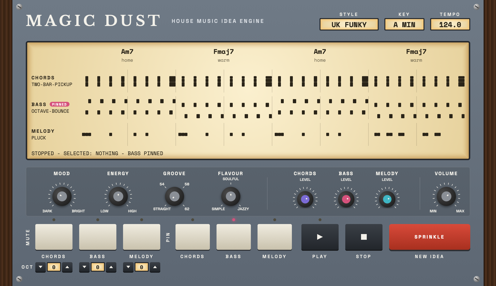
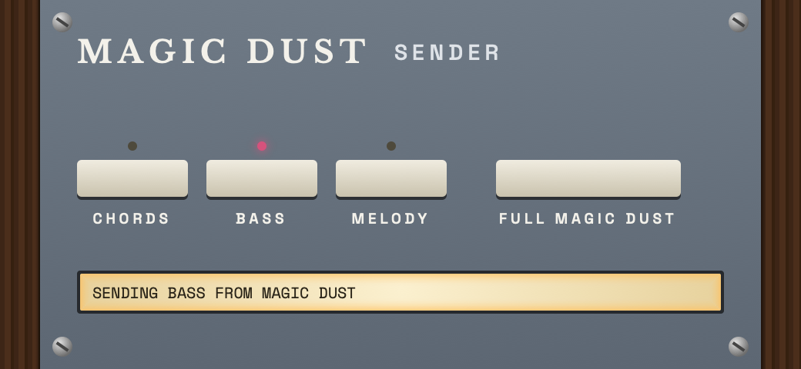

<h1 align="center">Magic Dust</h1>

<p align="center">House music idea engine. Chords, bass and melody that fit, at the press of one key.</p>

<p align="center">
  <a href="https://github.com/markstent/magic_dust_vst/actions/workflows/ci.yml"></a>
  
  
  
  <a href="LICENSE"></a>
  
  
</p>

<p align="center">
  
</p>

## What it is

Magic Dust is an instrument plugin for macOS that writes house music ideas for you.
Press the sprinkle key and it writes an 8-bar idea: chords, a bass line and a melody that fit together, in the key and style you chose.
The chords and rhythms are invented in the style, not picked from a list, so ideas keep surprising you.
Play it through the built-in house piano, sub bass and synth lead, or drag the chords and the lanes into your daw as MIDI clips and use your own sounds.

It is made by Mark Stent Digital.
It comes as an Audio Unit (AU) and a VST3 plugin, and it is open source under AGPLv3.

## Features

- The sprinkle key writes a new 8-bar idea with chords, bass and melody.
- Chord progressions and chord and melody rhythms are invented in the style of each family, learned from written examples.
  About 1 idea in 5 still uses a classic written progression or rhythm.
- Five style families, plus "UK funky house", a blend of all five: MK dub, soulful, bassline, festival and NY groove.
- Key and style menus on the top line.
- Eight bass patterns, from a sparse pedal to a rolling line, chosen by energy and kept clear of the chords.
- Mood, energy, groove and flavour knobs shape each idea.
- A level knob and a mute key for each part, and a master volume.
- A PIN key for each part: pin the chords, bass or melody you love, and sprinkle and the knobs rewrite the rest.
- An octave rocker for each part, from 2 octaves down to 2 up, for the built-in sound, MIDI out and dragged MIDI.
- Play, stop and the spacebar, to hear the idea with the built-in house piano, sub bass and synth lead.
- Ideas vary at the end of each phrase, with accents, ghost notes, a lazy timing feel and varied chord lengths and voicings, more as energy goes up.
- Drag a single chord, or a whole lane, into your daw as a MIDI clip.
- MIDI out on channels 1 to 3: chords on 1, bass on 2, melody on 3.
- Sender mode: play a part through your own synth, even in Ableton Live, which merges plugin MIDI to one channel.
- An about panel with the version and a link to this page.

## Install

### Download

There is no release yet.
The first release will have a signed `.dmg` installer on the [GitHub Releases page](https://github.com/markstent/magic_dust_vst/releases).
Until then, build Magic Dust from source.

### Build from source

You need:

- A Mac with Xcode or the Xcode Command Line Tools (`xcode-select --install`).
- [CMake](https://cmake.org) 3.25 or newer and [Ninja](https://ninja-build.org), for example `brew install cmake ninja`.
- An internet connection for the first build, which downloads JUCE (9.0.4), Catch2 and nlohmann/json for you.

Then run these in Terminal:

```
git clone https://github.com/markstent/magic_dust_vst.git
cd magic_dust_vst
cmake --preset dev
cmake --build --preset dev
```

The first build takes several minutes.
The `dev` preset builds for Apple Silicon (arm64).
Use the `release` preset (`cmake --preset release && cmake --build --preset release`) for a universal arm64 and x86_64 build.

The build copies the plugin to your plug-in folders:

- `~/Library/Audio/Plug-Ins/Components` for the AU
- `~/Library/Audio/Plug-Ins/VST3` for the VST3

A standalone app is built too.
Restart your daw, or rescan its plug-ins, so it finds Magic Dust.

## Quick start

1. Make a MIDI or instrument track in your daw and load Magic Dust on it.
2. Press PLAY, bottom right, to hear the first idea.
   Press your daw's own play and Magic Dust follows it.
3. Press the red sprinkle key for a new idea.
   Every press gives a different one.
4. Pick a style and a key from the top line, and turn the knobs until it feels right.
5. Like the chords but not the rest?
   Press the chords PIN key and sprinkle again.
   The chords stay and the bass and melody change.
6. Drag a chord or a lane from the screen onto a track to keep it as MIDI.

## Tutorial: your first track idea in Ableton Live

These steps are for Ableton Live 12.
The same ideas work in any daw.

1. **Load the plugin.**
   In Live, open Settings, then Plug-Ins, and switch on both Audio Units and VST3 system folders.
   Press Rescan.
   Make a MIDI track and drag Magic Dust from the Plug-Ins browser onto it.
   Use the VST3 version if you plan to use senders in step 9.
2. **Choose a style and a key.**
   Click STYLE on the top line and pick a family, or leave it on UK funky.
   Click KEY and pick a root note.
   TEMPO shows your daw's tempo.
3. **Sprinkle.**
   Press the red sprinkle key.
   The screen shows the chords and a row each for chords, bass and melody.
   Press play and listen, then sprinkle until you hear something you like.
4. **Shape it.**
   Mood runs from dark to bright and energy from low to high.
   Higher energy also gives a busier bass, and above halfway the bass leads into each chord change.
   Groove steps from straight through three swing settings.
   Flavour steps through simple, soulful and jazzy.
   Soulful is the chords as written, simple is plainer and jazzy is richer.
   A moment after you let go of mood, energy or flavour, the current idea is rewritten to match, and any part you are not changing stays put.
5. **Balance and mute.**
   Each part has a level knob.
   Double-click a level knob to put it back to its default, at three quarters of the way round.
   Press a MUTE key to drop a part out, and press it again to bring it back.
   A muted part stops its built-in sound and its MIDI out.
6. **Pin what you love.**
   Press a PIN key to keep that part.
   Its light glows in the part's colour, and its row on the screen says PINNED.
   Sprinkle again, or turn the knobs, and only the parts that are not pinned change.
   With the chords pinned, the new bass and melody are written to fit them.
   With the bass or melody pinned and new chords, the part keeps its rhythm and its notes move to fit the chords.
   Changing key moves the pinned parts into the new key.
   Press the PIN key again to let the part change.
   Pins, and the exact idea you hear, are saved with your project.
7. **Audition with the spacebar.**
   Click an empty part of the plugin window and press the spacebar.
   The preview starts, and the spacebar stops it again.
   If your daw is playing, Magic Dust follows it.
   Stop then only stops the preview, so use your daw's own stop.
8. **Drag chords and lanes into Live.**
   Drag a chord cell onto a MIDI track to get that one chord.
   Drag a lane onto a MIDI track to get that lane.
   The level knobs do not change the MIDI you drag out, but the octave rockers do.
   Lanes dropped at the same bar play in time with each other.
9. **Send a part to your own synth.**
   Live merges the MIDI from one plugin onto one channel, so each part you want to send needs its own Magic Dust.
   Use the VST3 version for this.
   The AU cannot send MIDI to other tracks in Live.
   1. Load Magic Dust (VST3) on a MIDI track.
      This is the main one, with the full screen.
   2. Make a second MIDI track and load Magic Dust (VST3) on it.
      It opens as the sender, with "SENDER" beside the name.
      The sender plays the part and the main one's built-in sound for that part goes quiet.
   3. Click CHORDS, BASS or MELODY on the sender to choose the part to send.
      The status window says what is sent, for example "SENDING BASS FROM MAGIC DUST".
   4. Make a third track and load your own instrument on it.
   5. On the instrument track, set MIDI From to the sender track.
   6. Set the chooser under it to Magic Dust.
   7. Set Monitor to In.
   8. Press play in Live.
      The sender plays only while Live plays, in time with the main Magic Dust, and makes no sound itself.

   Click "full magic dust" on a sender to turn it into a full Magic Dust of its own, with its own idea.

<p align="center">
  
</p>

## Controls reference

| Control | What it does |
| --- | --- |
| Wordmark | Opens the about panel with the version and the project link. |
| STYLE | Click to pick a style: UK funky, MK dub, soulful, bassline, festival or NY groove. |
| KEY | Click to pick the root note of the key. |
| TEMPO | Shows your daw's tempo. |
| Screen | Shows the four chords and the chord, bass and melody rows. Drag a chord cell or a lane out as MIDI. |
| MOOD | Dark to bright. |
| ENERGY | Low to high. Higher energy gives a busier bass, with notes that lead into each chord change above halfway. |
| GROOVE | Straight, or one of three swing settings (54, 58, 62). |
| FLAVOUR | Simple, soulful or jazzy chords. |
| CHORDS, BASS and MELODY LEVEL | Level of that part's built-in sound. Double-click to reset. Turn it up to +6 dB. |
| VOLUME | Master volume of the built-in sounds, up to +6 dB. |
| MUTE keys | Silence a part, both its built-in sound and its MIDI out. |
| PIN keys | Keep a part through sprinkle, the knobs and style changes. A pinned bass or melody keeps its rhythm and follows new chords. Pinned parts move with a key change. |
| OCT rockers | Move a part down or up in octaves, from -2 to +2. The built-in sound, the MIDI out and the MIDI you drag all follow. |
| PLAY | Plays the idea with the built-in sounds. |
| STOP | Stops the preview. It does not stop your daw. |
| SPRINKLE | Writes a new idea. |
| Spacebar | Starts and stops the preview, after you click an empty part of the window. |
| Sender: CHORDS, BASS, MELODY | Choose the part this sender sends. |
| Sender: FULL MAGIC DUST | Turns the sender into a full Magic Dust. |

## Tips

- Sprinkle often. Every press is a new idea.
- Found chords you love? Pin them and sprinkle until the bass and melody match.
- Pin a bass line you love, then sprinkle for new chords under it.
- Drag the lanes you like out as MIDI before you sprinkle again, so you can change the sounds later.
- Muting a part also stops its MIDI out, so a sender goes quiet too.
- Flavour changes the chords, so try jazzy on a soulful idea and simple on a festival one.
- Turn energy up for a busier bass, and down for a sparse one.

## Roadmap

These are planned and not built yet:

- Pin a single chord, and reroll the rest.
- Swap a chord for the next best fit.
- Keep an idea in your favourites.
- "Bottle it": drag the whole idea out in one go.
- A list of your recent ideas.
- A pattern knob for each part.

The full product spec is in [`docs/spec/`](docs/spec/).
Decisions that depart from it are in [`docs/DECISIONS.md`](docs/DECISIONS.md).

## Building and testing

Notes for developers.
The full guide is [`docs/TESTING.md`](docs/TESTING.md).

```
cmake --preset dev && cmake --build --preset dev
ctest --preset dev
ctest --preset dev -L plugin
cmake --preset lint && cmake --build --preset lint
scripts/validate.sh
```

- `ctest --preset dev` runs every automatic test, and `-L plugin` runs only the plugin tests.
- The `lint` preset builds with clang-tidy switched on, and `scripts/format-check.sh` checks clang-format.
- `scripts/validate.sh` runs pluginval on the VST3 and the AU, then Apple's `auval` on the AU.
- `MD_PROPERTY_SEEDS=10000 ctest --preset release -R properties` runs the long property check.
- The `asan` and `tsan` presets build with the address, undefined behaviour and thread sanitizers.
- The style bank is a set of JSON files in `bank/entries`, built with the Python tools in `tools/bank-builder` (managed with `uv`).
- GitHub Actions (`.github/workflows/ci.yml`) runs lint, the dev and release tests, plugin validation, the sanitizers and the Python checks on every push and nightly.

## Contributing

Issues and pull requests are welcome.
Work on a branch, add a test with every change, and make sure lint, format and tests pass before you open a pull request.

## Licence

Magic Dust is released under the [GNU Affero General Public License v3.0](LICENSE).
It is built with [JUCE](https://juce.com), which is used under its AGPLv3 option.
