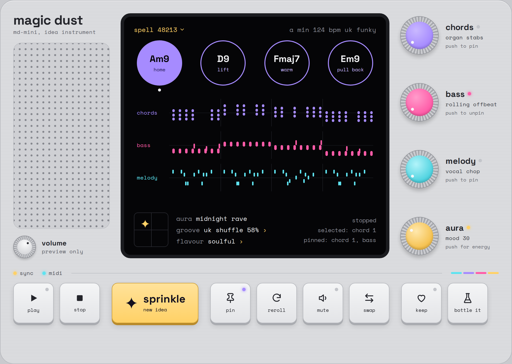
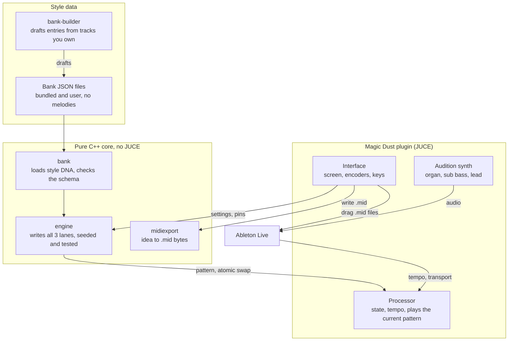
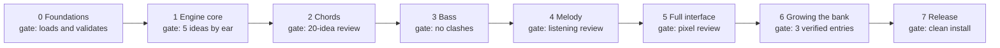

# Magic Dust: product and build spec

Version 1.0, 26 October 2026.

Magic Dust is a Mac plugin (AU and VST3) for Ableton Live that writes matching chords, bass and melody for UK funky house.
This file is the complete brief for building it.
The look and behaviour of the interface are defined in the companion file `magic-dust-visual-spec.md` and the `visual/` folder.

## Contents

1. How to use this spec
2. Product overview
3. Interface summary
4. Music engine
5. Style DNA bank
6. Architecture
7. Repository, tooling and engineering rules
8. Build plan
9. Testing strategy
10. Using Magic Dust
11. Deployment
12. Open questions and future ideas
13. Glossary

## 1. How to use this spec

Build Magic Dust one phase at a time, in the order of the build plan, and stop for the owner's sign-off at every gate.
This section is written for the Claude instance that builds the product, for example Claude Code running on the owner's Mac.

### The files

| File | Purpose |
| --- | --- |
| `magic-dust-spec.md` | This file: product, music engine, bank, architecture, tooling, plan, testing, use and release. |
| `magic-dust-visual-spec.md` | The interface: layout measurements, colour tokens, type, materials, every component and its states, motion and the JUCE component map. |
| `visual/magic-dust-reference.html` | A playable reference of the interface. Open it in a browser and use it as the source of truth for appearance. |
| `visual/magic-dust-ui.png` | The default state. |
| `visual/magic-dust-ui-annotated.png` | The default state with numbered zones that match the visual spec. |
| `visual/magic-dust-ui-states.png` | Playing, pinned, selected and muted states, the spells panel and a toast. |

Copy all of these into the repository's `docs/spec/` folder in Phase 0 so they travel with the code.

### Working rules

- **Who you are building for.**
  The owner is a house music producer, not a developer.
  They use a Mac and Ableton Live 12 and know a little scripting.
  Do the engineering yourself, and explain every command they must run in plain words.
- **Read everything first.**
  Read this file, the visual spec and the reference HTML before writing code.
  Where they are silent, choose the option with the best quality, simplicity, robustness, scalability and long-term maintainability.
  Development effort is never a reason to pick a weaker option.
- **Work in phases.**
  Each phase ends with a demo the owner can try in Ableton and a green test run.
  Do not start the next phase until the owner confirms.
- **Log departures.**
  Keep `docs/DECISIONS.md`.
  Record every choice that departs from the spec, with the reason and the date.
- **Let the owner's ears decide taste.**
  When two musical options are both valid, for example two voicing styles, render both as MIDI clips and ask the owner to compare them in Ableton.
  Never settle a taste question silently.
- **Ask before** buying anything, creating accounts (Apple Developer, GitHub), or changing the product's scope.

## 2. Product overview

Magic Dust writes an 8-bar idea (chords, bass and melody that fit together) at the press of one key.
A producer who doesn't know music theory gets a strong starting point in seconds and drags it straight into Ableton.

**The metaphor.**
Sprinkle a little magic dust and an idea appears.
Pin the parts you love and sprinkle again; the spell keeps them while everything else changes.

**Who it's for.**
The owner makes UK funky house in the vein of MK, Sonny Fodera, Gorgon City, Solardo and Dennis Quin.
They have strong taste but little theory.
Existing chord plugins felt generic, not house-specific, and clunky in Ableton.

### Goals for version 1

1. One key writes an 8-bar idea: chords, bass and melody, written together so they always fit.
2. It sounds like UK club house out of the box: extended chords, organ and piano stabs, offbeat and rolling bass, pluck hooks.
3. No theory is needed.
   Controls use feel words (aura, groove, flavour), and chords are labelled by feel (home, lift, tension).
4. Pin and reroll work at every level: one chord, one lane, or the whole idea.
5. Any chord, any lane, or the whole idea drags into Ableton as a MIDI clip that keeps the groove.
6. Every idea can be recreated exactly from its idea code.
7. A Style DNA bank grows from tracks the owner loves.
   It stores progressions and grooves, never melodies.

### Not in version 1

- Sound design.
  The built-in sounds exist only to audition ideas.
- Drums, full-song arrangement, and audio effects.
- A Windows build.
  Keep the code portable so one can be added later.
- Accounts, cloud features, or an AI model at runtime.
  The engine is rule-based, driven by the bank, and deterministic.

### How we know it works

| Measure | Target |
| --- | --- |
| Time from an empty Live set to a dragged-in idea | Under 60 seconds |
| Ideas the owner rates "keep" in the listening review | At least 1 in 3 |
| Plugin validation | pluginval at strictness 10 and Apple `auval` both pass |
| Stability | Zero crashes or hangs across the Ableton end-to-end checklist |
| Interface fidelity | No visual defects in the side-by-side review against `visual/` |

## 3. Interface summary

The interface looks like a boutique hardware instrument: a brushed-aluminium body, a black screen, ridged encoders with coloured caps, and chunky keycaps.
The full definition is in `magic-dust-visual-spec.md`; this section is only an overview.



- **Left column:** the "magic dust" wordmark, a speaker grille that pulses with the preview, and a volume knob for the audition sound.
- **Screen:**
  - **Top line:** the spell number (opens recent spells), key, tempo from Live, and style.
  - **Chord bubbles:** four chords with feel words.
    Click to select and audition; drag to export.
  - **Lanes:** chords, bass and melody piano rolls.
    Click to select; drag to export.
  - **Status strip:** the aura pad (mood and energy), groove and flavour fields, and a readout of bar, selection and pins.
- **Encoders:** chords, bass and melody (turn to change pattern, push to pin), and aura (turn for mood, push to switch to energy).
- **Keycaps:** play, stop, sprinkle, pin, reroll, swap, keep, and bottle it, and a mute key for each lane.

### Words in the interface

The interface speaks in the metaphor, but every word must also be obvious without it.
Each control has a tooltip.

| Word | What it does |
| --- | --- |
| Sprinkle | Write a new idea. Pinned parts stay. |
| Pin | Lock a chord or lane so sprinkle and reroll leave it alone. |
| Reroll | Rewrite the selected chord or lane, keeping everything else. |
| Swap | Replace the selected chord with the next ranked alternative. |
| Bottle it | Drag the whole idea into Ableton. |
| Keep | Save the idea to favourites. |
| Spells | Recent ideas, opened from the spell number on the screen. |
| Aura | Mood and energy: the gold encoder, or the sparkle on the screen's aura pad. |

## 4. Music engine

The engine turns a style family, key, aura, groove, flavour, seed and pins into an 8-bar idea with three MIDI lanes.
Chords are written first.
Bass and melody are written from the chords, which is why they always fit.

### Pipeline

1. **Resolve settings.**
   Load the style family from the bank.
   Map aura, groove and flavour to numeric parameters.
   Derive lane seeds from the idea seed.
2. **Choose a progression** from the family's templates, weighted by mood and respecting pinned chords.
3. **Spell chords.**
   Turn scale degrees into chord symbols, adding extensions for the flavour.
4. **Voice chords** using the voice-leading cost rules below.
5. **Apply chord rhythm:** a pattern from the bank, plus swing and velocity.
6. **Write the bass** from chord roots and a bass pattern.
7. **Write the melody** from chord tones and motif rules, or in pluck mode.
8. **Humanize** timing and velocity, deterministically from the seed.
9. **Validate** against the rules at the end of this section, then output the idea.

### Data model

| Type | Holds |
| --- | --- |
| `Key` | Root pitch class (0 to 11) and mode (aeolian, dorian, phrygian, ionian, mixolydian) |
| `ChordSymbol` | Scale degree, quality (min7, min9, min11, maj7, maj9, dom7, dom9, sus4, 6, add9), alterations, feel word |
| `Voicing` | Sorted MIDI note numbers |
| `NoteEvent` | Pitch, start and length in ticks (960 per quarter note), velocity |
| `Lane` | Lane id (chords, bass, melody), pattern id, events, pinned, muted, lane seed |
| `Idea` | Idea seed, settings snapshot, bank version, progression, three lanes |

### How the controls map to music

| Control | Low end | High end |
| --- | --- | --- |
| Aura, left to right (mood) | Aeolian and phrygian, few major chords | Dorian and ionian, more maj7 and add9 colours |
| Aura, bottom to top (energy) | 2 chord hits per bar, offbeat bass, 3 melody notes per 2 bars, velocity around 80 | 6 chord hits per bar, rolling bass with approach notes, up to 10 melody notes per 2 bars, velocity around 110 |
| Groove | Straight: swing 50% | Heavy: swing 62% (swing 54% and uk shuffle 58% in between) |
| Flavour | Simple: triads and 7ths | Jazzy: 9ths, 11ths and 13ths, with an altered dominant allowed on the last chord (soulful: 7ths, 9ths and passing sus4 in between) |

Swing applies to 16th notes.
At 58%, the second 16th of each pair lands 58% of the way through its 8th note instead of halfway.

### Patterns

Each lane encoder steps through these patterns, in this order.

| Lane | Patterns |
| --- | --- |
| Chords | organ stabs, piano chops, long pads, offbeat stabs |
| Bass | rolling offbeat, offbeat, octave bounce, garage skip, sustained |
| Melody | pluck, hook, riff, sparse |

### Chord rules

- **Templates.**
  Progressions come from the bank in scale degrees, for example `i9 iv9` or `i7 VImaj7 IIImaj7 VII`.
  Each chord lasts 1 or 2 bars, and the template repeats to fill 8 bars.
- **Feel words** come from harmonic function: the home chord is "home"; iv, IV and ii are "lift"; VI and III are "warm" or "bright"; v, VII and dominants are "tension" or "push"; a chord that leads back home is "pull back".
- **Voicing candidates** per chord: close position (4 notes), drop-2, organ stab, and piano spread.
- **Voicing choice** minimizes a cost: total semitone movement from the previous voicing (weight 1.0), top-note smoothness (weight 0.5), and large penalties for notes out of range or muddy low intervals.
- **Range.**
  Voicings stay within MIDI 48 to 79 (C3 to G5), with the top note between 62 and 77.
- **Mud rule.**
  No interval smaller than a perfect 4th below MIDI 52 (E3), and no 3rds below MIDI 48 (C3).
- **Parallel mode** (the classic house "chord memory" stab) keeps one voicing shape and moves it with the root.
  The style decides whether notes may leave the key.
- **Rhythm.**
  A chord pattern is a 1- or 2-bar cell of 16th-step onsets with lengths.
  Stabs are 1 to 2 sixteenths; pads hold for the whole chord.
- **Ranked alternatives** for the swap key: for each slot, rank candidate chords by fit with the neighbouring chords and the current mood, and step through them in that order.

### Bass rules

- **Range** MIDI 28 to 48 (E1 to C3).
  The bass is monophonic: no overlapping notes.
- **Notes.**
  The current chord's root by default.
  Patterns may use octaves and 5ths.
  At energy above 0.5, add an approach note (a scale step or half step) on the last 16th before a chord change.
- **Kick-friendly by default.**
  Avoid onsets on the four downbeats unless the pattern asks for them, so the bass sits around a four-to-the-floor kick.

### Melody rules

- **Range** MIDI 60 to 84 (C4 to C6).
- **Motif.**
  Two bars of 4 to 8 notes, using a rhythm cell from the bank.
  Strong beats take chord tones; weak beats take scale tones.
- **Shape.**
  Leaps are at most 7 semitones, except octaves.
  After a leap larger than 4 semitones, the next move steps back the other way.
- **Phrase form** over 8 bars: A, A-variation, A, B (or A, B, A, B-variation).
  The last 2 bars land on a chord tone of the home chord.
- **No clashes.**
  On strong beats, never put a melody note a half step away from a sounding chord tone.
- **Pluck mode** (the MK sound): 1 to 3 pitches taken from chord tones, mostly 16th notes, with stutter repeats, syncopation and gaps.
  It plays a short pluck sound, and it also suits loading a vocal into a sampler.
  It is meant to drive a sampler holding chopped vocal syllables.

### Pin, reroll and seeds

- **Random numbers.**
  Use PCG32, seeded per lane from a hash of the idea seed, lane id and chord slot.
  Rerolling the bass never changes the melody's random stream.
- **Sprinkle** picks a new idea seed and regenerates everything that isn't pinned.
  Unpinned chord slots are chosen with the pinned chords as constraints.
- **Lane reroll** changes only that lane's seed.
- **Chord changes ripple.**
  When chords change, unpinned bass and melody regenerate.
  A pinned bass or melody that would clash is refitted: pitches snap to the nearest chord or scale tone, the rhythm stays, and the lane shows a small "refitted" badge.
- **Aura and flavour changes** regenerate unpinned parts with the same seed, 150 ms after movement stops.
- **Determinism.**
  The same seed, settings and bank version always produce byte-identical MIDI.
  The engine never reads the clock, never calls `std::rand`, and never lets hash-map ordering affect a choice.
- **Idea codes.**
  The screen shows a short spell number (the seed).
  A copyable idea code (base32, about 13 characters) packs the seed, settings and bank version, and recreates the idea exactly.

### Validation rules

The engine checks every idea before returning it, and tests assert the same rules.

- Every note sits inside its lane's range.
- Bass notes never overlap.
- Every note is in the key unless the chord symbol or parallel mode allows it.
- Outside parallel mode, no voice moves more than 7 semitones between consecutive voicings.
- The idea is exactly the chosen length: 8 bars by default, or 4 or 16.
- A full idea generates in under 20 ms on an Apple M1.

## 5. Style DNA bank

The bank is a set of versioned JSON files that describe how each style family writes chords, bass and melody.
It stores progressions, voicing styles and rhythm cells.
It never stores melodies or audio.

### Style families

The style menu offers each family plus "UK funky house", a weighted blend of all five that is the default.
Tempo ranges are starting estimates; confirm them with the analysis tool.

| Family | Inspired by | Tempo | Signature |
| --- | --- | --- | --- |
| MK dub | MK; Nightcrawlers "Push the Feeling On" (MK dub) | 122 to 126 BPM | Organ stabs, organ bass, pluck hook, 909 groove |
| Soulful | Sonny Fodera | 122 to 125 BPM | Warm 7th and 9th chords, smooth voice leading, piano and Rhodes |
| Bassline | Gorgon City | 122 to 126 BPM | Bass-led, UK garage swing, sparser chords |
| Festival | Solardo ("The Juice", "Freedom") | 126 to 130 BPM | Fewer chords, driving bass, rising stabs, build-ups |
| NY groove | Dennis Quin | 122 to 126 BPM | Chopped chord rhythms, raw stabs, bass-driven groove |

### Entry format

One JSON file per entry, validated against `bank/schema.json`.
In `hits`, each pair is a 16th-note step and a length in 16ths.

```json
{
  "schemaVersion": 1,
  "id": "mk-dub-starter-01",
  "family": "mk-dub",
  "name": "Two-chord organ loop",
  "source": { "kind": "hand-authored", "reference": null, "confidence": "placeholder" },
  "tempo": { "min": 122, "max": 126 },
  "modes": ["aeolian", "dorian"],
  "progressions": [
    { "degrees": ["i7", "iv7"], "barsPerChord": 2, "weight": 1.0 }
  ],
  "voicing": { "style": "organ-stab", "parallel": true, "topNote": [67, 76] },
  "chordRhythms": [
    { "id": "offbeat-stabs", "bars": 1, "hits": [[2, 1], [6, 1], [10, 1], [14, 1]] }
  ],
  "bassPatterns": ["offbeat", "octave-bounce"],
  "melodyModes": ["pluck"],
  "swing": 0.56,
  "tags": ["mk-ish", "peak time"]
}
```

### Bank rules

- **No melodies, by construction.**
  The schema sets `additionalProperties: false` and has no field for pitch sequences beyond chord degrees and rhythm cells.
  Melody and pluck behaviour are engine rules, not stored lines.
- **Confidence levels:** `placeholder` (hand-authored starter), `estimated` (from the analysis tool, not yet checked by ear), and `verified` (the owner confirmed it by ear).
  The generator gives verified entries double weight.
- **Where it lives.**
  Bundled entries ship inside the plugin as binary data.
  User entries live in `~/Library/Application Support/Magic Dust/bank/` and add to the bundled set.
- **Versioning.**
  The bank version is a hash of every loaded entry.
  Each idea stores it, so an old idea code can warn when the bank has changed.

### Starter progressions

These are common house moves, written in scale degrees so they work in any key.
Hand-author at least 6 progressions and 6 chord rhythms per family as `placeholder` entries.

| Degrees | Bars per chord | Families | Feel words |
| --- | --- | --- | --- |
| `i7 iv7` | 2 | MK dub, NY groove | home, lift |
| `i9 IV9` | 2 | Soulful | home, bright lift |
| `i7 VImaj7 IIImaj7 VII` | 2 | Soulful, Festival | home, warm, bright, push |
| `i9 VII VImaj7 VII` | 2 | Festival | home, push, warm, push |
| `i9 v7` | 2 | Bassline | home, tension |
| `i11` (one-chord vamp; the rhythm carries it) | 8 | NY groove, Festival | home |
| `iv9 v9 i9` | 2, 2, 4 | Soulful | lift, tension, home |
| `VImaj9 VII6 i9` | 2, 2, 4 | Festival, Soulful | warm, push, home |

### Filling the bank

1. **Starter entries** (Phase 1): hand-authored from general house practice and marked `placeholder`.
2. **Analysis tool** (Phase 6): `tools/bank-builder`, a Python command-line tool.
   It takes an audio file the owner owns, or a MIDI clip, and drafts an entry: tempo, key, the chord progression per bar as degrees, chord rhythm onsets, and a section map.
   It uses librosa for tempo, beats and chroma, and matches chroma against chord templates per beat.
   A MIDI clip made with Ableton's "Convert Harmony to New MIDI Track" gives more accurate chords than raw audio.
   The tool never writes melody notes.
3. **Learn from clip** (Phase 6, in the plugin): drag a MIDI clip onto the screen.
   The plugin extracts its DNA (the progression relative to the detected key, the chord rhythm cell and the voicing style) and saves a user entry once the owner names it.
4. **Licensed MIDI packs** the owner buys (royalty-free house packs) go through Learn from clip too.
5. **Manage bank** (from the style menu) lists entries, plays them, and has a "sounds right" button that marks an entry `verified`.

### Reference tracks

| Track | Family | Next step |
| --- | --- | --- |
| Nightcrawlers, "Push the Feeling On" (MK dub) | MK dub | Analyze |
| Solardo with Stevie Appleton, "The Juice" | Festival | Analyze |
| Solardo, "Freedom" | Festival | Analyze |
| A favourite MK track | MK dub | Owner to pick |
| A favourite Sonny Fodera track | Soulful | Owner to pick |
| A favourite Gorgon City track | Bassline | Owner to pick |
| A favourite Dennis Quin track | NY groove | Owner to pick |

## 6. Architecture

Magic Dust has three layers: a pure C++ engine with no JUCE dependency, a JUCE plugin shell, and the interface.
Ideas are generated on the message thread; the audio thread only plays a finished, immutable pattern.



### Modules

| Module | Responsibility | Depends on |
| --- | --- | --- |
| `engine` | Theory model, generators, PCG32, validation, idea codes | C++20 standard library only |
| `bank` | Load and validate JSON entries into engine types | `engine`, nlohmann/json |
| `midiexport` | Turn an idea into Standard MIDI File bytes | `engine` |
| `plugin` | JUCE audio processor: parameters, saved state, host tempo and transport, preview playback | JUCE, all of the above |
| `synth` | Three audition voices: organ, sub bass, pluck | JUCE |
| `ui` | Look and feel, tokens, screen, encoders, keycaps, drag sources (see the visual spec's component map) | JUCE, `plugin` |
| `tools/bank-builder` | Draft bank entries from audio or MIDI the owner owns | Python 3, librosa |

Keeping `engine`, `bank` and `midiexport` free of JUCE means all the music logic is tested quickly, in plain unit tests, without loading a plugin.

### Threads

- **Message thread:** interface, generation (under 20 ms), and writing drag files.
- **Audio thread:** reads the current playback pattern through an atomic pointer.
  It never allocates memory, takes a lock, or touches files.
- **Publishing a pattern:** build it on the message thread, then swap it in with an atomic exchange.
  Old patterns are freed later on the message thread, never on the audio thread.
- **Background thread:** Learn from clip and any other slow analysis.

### Parameters and saved state

- **Host parameters** (automatable): aura mood, aura energy, groove, flavour, and preview volume.
  Three more set the level of each lane's built-in sound: chords level, bass level and melody level.
  Each runs from 0 to 1 and starts at 1.
  A built-in voice plays at the preview volume times its lane level.
  The levels never change the MIDI out.
  Three more mute each lane: chords mute, bass mute and melody mute, off by default.
  Three more set the octave of each part: chords octave, bass octave and melody octave, each from -2 to +2 and 0 by default.
  A part's notes move 12 semitones per step in its built-in sound, its MIDI out and the MIDI dragged out, and a note that would leave MIDI's 0 to 127 is dropped.
  A sender follows its main instance's octave for its lane.
  A muted lane plays nothing, neither its built-in sound nor its MIDI out, and a sender follows the main instance's mutes.
  Three more pin each lane: chords pin, bass pin and melody pin, off by default.
  A pinned lane survives sprinkle, the aura, groove and flavour knobs, and style changes, and mute and pin are independent.
- **Live response.**
  Groove changes apply instantly (swing only).
  Aura and flavour changes regenerate unpinned parts with the same seed after a 150 ms pause in movement, so the owner hears the change without losing the idea.
- **Saved with the Live set:** the current idea (seed, settings, pins, lane seeds, patterns, refit flags), the last 8 spells, window size, the motion setting, and a state schema version.
  Reopening the set restores the idea exactly, including refitted pinned lanes.
  A set saved before the idea was stored loads from its seeds.
- **Saved across projects:** favourites, mirrored to `~/Library/Application Support/Magic Dust/favourites.json`.

### Ableton integration

- **Plugin type.**
  An instrument (AU type `aumu`, VST3 instrument), so it sits on a MIDI track and makes sound for auditioning.
- **Plugin identity.**
  Name "Magic Dust".
  Use a four-character manufacturer code with at least one capital letter and a four-character plugin code with exactly one, for example `Mdus` and `Mdst`.
  Bundle id `com.<owner>.magicdust`.
- **Tempo and transport.**
  Read the host's tempo, position and play state from JUCE's `AudioPlayHead::getPosition()`.
  When Live plays, the preview follows Live's position, looping 8 bars from bar 1.
  When Live is stopped, the play key runs an internal clock at the host tempo.
- **Drag to Ableton** is the main way MIDI reaches Live.
  - On drag start, write the MIDI file to `~/Library/Caches/Magic Dust/drag/` and call `juce::DragAndDropContainer::performExternalDragDropOfFiles`.
    Delete files older than 24 hours at startup.
  - Files use 960 ticks per quarter note and carry a tempo event and a 4/4 time signature.
    Swing, velocity and humanizing are baked in.
  - Name files clearly, for example `Chords - Am9 D9 Fmaj7 Em9 - 124bpm.mid`, using a plain hyphen.
  - A lane or a single chord is a one-track file.
    "Bottle it" is a multi-track file (Chords, Bass and Melody tracks) with the chord names as marker events.
    Test how Live lays this out; if it doesn't create separate tracks, drag the three single-track files at once instead.
- **MIDI output** to other tracks is an optional extra.
  Test which formats deliver it in Live 12 before promising it in the interface.

## 7. Repository, tooling and engineering rules

One Git repository builds everything with CMake, pins every dependency to an exact version, and runs the full test suite in CI on every push.

### Tools on the owner's Mac

| Tool | How to install | Used for |
| --- | --- | --- |
| Xcode (latest stable) | Mac App Store | Apple compilers, SDKs and code signing |
| Xcode command line tools | `xcode-select --install` | Command-line builds |
| Homebrew | Install script from brew.sh | Installing everything below |
| CMake (3.25 or newer) and Ninja | `brew install cmake ninja` | The build system |
| Git and GitHub CLI | `brew install git gh` | Version control and CI |
| Python 3.11 or newer | `brew install python` | The bank-builder tool and schema checks |
| pluginval | Download from Tracktion's GitHub releases | Plugin validation |
| Ableton Live 12 | Already installed | End-to-end testing |

### Dependencies

- **JUCE 8**, fetched by CMake `FetchContent` at an exact release tag.
  Read JUCE's current licence terms before sharing the plugin with anyone else.
- **Catch2 v3** and **nlohmann/json 3**, each at an exact tag.
- **Python packages** (librosa, numpy, mido, jsonschema) pinned in a lock file under `tools/bank-builder/`.
- **Fonts:** Space Grotesk and Space Mono, with their SIL Open Font License files, in `ui/fonts/`.
- **Upgrade rule:** never track "latest".
  Upgrade one dependency per commit, after the full test suite passes, and only to releases at least two weeks old.

### Repository layout

```text
magic-dust/
  CMakeLists.txt
  CMakePresets.json
  cmake/                dependency fetching, warnings, signing helpers
  engine/               pure C++ music engine (include/md/, src/)
  bank/                 loader, bundled entries (*.json), schema.json
  midiexport/           Standard MIDI File writer
  plugin/               JUCE processor, audition synth, saved state
  ui/                   JUCE components, look and feel, tokens, fonts/
  tests/                unit, golden, plugin and UI snapshot tests
  tools/bank-builder/   Python analysis tool
  scripts/              build, validate, package, notarize
  docs/                 DECISIONS.md, USER_GUIDE.md, TESTING.md, spec/
  .github/workflows/    ci.yml, release.yml
```

### Build commands

| Command | What it does |
| --- | --- |
| `cmake --preset dev` | Configure a Debug build for Apple Silicon with Ninja |
| `cmake --build --preset dev` | Build, then copy the AU and VST3 into `~/Library/Audio/Plug-Ins` |
| `ctest --preset dev` | Run every automated test |
| `cmake --preset release` | Configure a universal (arm64 and x86_64) Release build, macOS 11.0 minimum |
| `scripts/validate.sh` | Run pluginval at strictness 10 on AU and VST3, then `auval` on the AU |

### Code standards

- C++20.
  Our code compiles with `-Wall -Wextra -Wpedantic -Werror`; third-party code is excluded.
- clang-format and clang-tidy configs are checked in and enforced in CI with zero warnings.
- CI runs the tests under AddressSanitizer and UndefinedBehaviorSanitizer, and the plugin tests under ThreadSanitizer.
- Audio-thread code is marked and reviewed.
  In test builds, a guard fails the test if the audio thread allocates memory.
- Musical ranges and limits live in one header, `engine/include/md/ranges.hpp`, never as scattered numbers.
- Interface colours, sizes and timings live in one header, `ui/Tokens.h`, using the token names from the visual spec.

### Engineering rules

These are the owner's standing rules.
Follow them exactly.

- Never add an AI agent's name as co-author or collaborator in a commit message.
- Never hand-edit `CHANGELOG.md` or any file marked as auto-generated.
  The changelog is generated at release time from Conventional Commit messages.
- Never use the em dash character (Unicode U+2014) in code, comments, docs or interface text.
  Use a plain hyphen.
- In long Markdown files, put each full sentence on its own line while keeping normal Markdown structure.
- Prefer quality, simplicity, robustness, scalability and long-term maintainability over development cost.
- Fix a bug by first reproducing it end to end, as close as possible to how the owner would hit it in Ableton.
  Capture it in a failing automated test, then fix it.
- Be picky about the interface.
  If anything looks off during testing, even if it's unrelated to the current task, fix it along the way.
- Treat every lint warning, test failure and flaky test as a bug to fix now, even if it's unrelated to the current task.
  Never skip or disable a test to get a green run.

### Continuous integration

Every push runs on a GitHub Actions macOS runner: format and lint checks, bank schema validation, Debug and Release builds, all tests, the sanitizer jobs, and pluginval on the built plugins.
A red run blocks merging.

## 8. Build plan

The build runs in eight phases.
Each phase ends at a gate: something the owner can try in Ableton, plus a green CI run.
Music is audible from Phase 1, through a small command-line tool, long before the full interface exists.



### Phase 0: Foundations

- **Build:** install the toolchain, create the repository, presets and CI, copy the spec files into `docs/spec/`, and build an empty JUCE instrument as AU, VST3 and a standalone app.
- **Done when:** CI is green, pluginval passes at strictness 10, `auval` passes, and the owner loads "Magic Dust" on a MIDI track in Live.

### Phase 1: Engine core

- **Build:** theory types, PCG32 and lane seeds, idea codes, validation rules, the bank loader and schema, starter entries for all five families, the MIDI file writer, and `md-cli`.
  Running `md-cli --style mk-dub --seed 48213 --out idea.mid` writes an idea to disk.
- **Done when:** unit and golden tests pass, and the owner drags five `md-cli` ideas into Live and hears three lanes that fit together.

### Phase 2: Chords, end to end

- **Build:** the full chord generator (templates, spelling, voicing, rhythm, swing), the organ audition voice, preview playback synced to Live, and a minimal interface with the sprinkle key, four chord bubbles, the chord lane, and drag to Ableton.
- **Done when:** the owner sprinkles 20 ideas in Live, drags favourites into clips, and rates them in the listening review.

### Phase 3: Bass

- **Build:** the bass generator and its five patterns, approach notes, kick-friendly placement, the sub-bass voice, the bass lane, and refitting of pinned lanes.
- **Done when:** the listening review passes and automated tests show no bass note clashes with a sounding chord.

### Phase 4: Melody

- **Build:** the motif generator, phrase forms, pluck mode, the pluck voice, and the melody lane.
- **Done when:** the listening review passes, including at least three pluck ideas the owner would load a vocal sample against.

### Phase 5: Full interface

- **Build:** the complete interface from `magic-dust-visual-spec.md`: tokens and fonts, materials, every component and state, selection, pins, rerolls, mute, swap, spells, keep, toasts, motion, resizing, accessibility, and saved state.
- **Done when:** UI snapshot tests pass, a side-by-side review against the images in `visual/` and the reference HTML finds no visual defects, and the full Ableton end-to-end checklist passes.

### Phase 6: Growing the bank

- **Build:** `tools/bank-builder`, Learn from clip, manage bank, and the user bank folder.
  Then analyze the reference tracks together with the owner.
- **Done when:** at least three `verified` entries exist from the owner's own reference tracks, and ideas from them pass the listening review.

### Phase 7: Polish and release

- **Build:** a performance pass, the universal Release build, code signing, notarization, the installer, `docs/USER_GUIDE.md`, and the v1.0.0 tag.
- **Done when:** a clean install works on a second macOS user account, the full end-to-end checklist passes on the installed build, and the owner signs off on v1.0.0.

## 9. Testing strategy

Every rule in this spec gets an automated test, and every phase is also checked in Ableton and by ear.
A plugin can pass every unit test and still sound bad.

### Test layers

| Layer | What it checks | When it runs |
| --- | --- | --- |
| Unit tests (Catch2) | Scales, chord spelling, voicing costs, PCG32, idea code round trips, bank loading, MIDI file bytes | Every push |
| Property tests | Across many seeds, every family and all four aura corners: every validation rule holds, and generation stays under 20 ms at the 99th percentile | 1,000 seeds per push; 10,000 nightly |
| Golden tests | 50 fixed seed-and-settings pairs produce byte-identical MIDI files, stored under `tests/golden/` | Every push |
| Plugin tests | Saved state round trip, parameter changes, tempo changes, the audio-thread allocation guard, preview timing at 44.1, 48 and 96 kHz with buffers from 32 to 2048 samples | Every push |
| Plugin validation | pluginval at strictness 10 on AU and VST3, plus `auval` | Every push and every release |
| UI snapshot tests | Each component and the full window, rendered offscreen at 100% and 150%, compared with approved reference renders | Every push |
| Ableton end-to-end | The checklist below, on a real Live set | Every phase gate and release |
| Listening review | The owner rates ideas keep, close or skip | Every phase gate |

### Golden test changes

A golden test failing means the music changed.
Never update golden files casually.
Run `scripts/update-golden.sh`, which writes before and after MIDI files side by side.
The owner listens to the differences in Live and approves the change before the new golden files are committed.

### UI snapshot rules

Snapshot rendering uses the bundled fonts, so snapshots match on every Mac.
A snapshot fails when more than 0.5% of pixels differ from the approved reference.
Review every failing diff by eye before approving a new reference.
The first approved references are signed off against the images in `visual/` in a side-by-side review with the owner.
Hold the interface to a pixel-perfect standard: misaligned edges, clipped text, uneven spacing and blurry icons are bugs.

### Listening review

For each family, the owner sprinkles 20 ideas with varied aura settings and rates each keep, close or skip.
The target is at least 1 in 3 keep.
Notes on what sounded off, such as "bass too busy" or "chords too jazzy for Festival", become rule changes or bank weight changes, each recorded in `docs/DECISIONS.md`.

### Ableton end-to-end checklist

Run this on the build under test, in a fresh Live set.

- [ ] Rescan plugins.
      Magic Dust appears as both AU and VST3.
- [ ] Load it on a MIDI track.
      The window opens at full size with no visual defects, at 100% and 150%.
- [ ] Set Live to 124 BPM; the plugin shows 124.
      Change to 128 while playing; the preview follows.
- [ ] Sprinkle 10 times.
      Every idea plays, the spell number changes, and the spells panel shows the 8 most recent.
- [ ] Pin chord 2 and sprinkle.
      Chord 2 stays the same.
- [ ] Pin the bass lane and swap a chord.
      The bass refits and shows its badge.
- [ ] Drag each lane to its own MIDI track.
      Each clip is 8 bars, starts at bar 1, keeps the swing, and matches the preview note for note.
- [ ] Drag a single chord bubble.
      The clip holds just that chord, at its length.
- [ ] Use bottle it.
      Record how Live lays out the tracks.
- [ ] Turn each encoder, push it, and use the scroll wheel.
      The pattern, pin LED and hint update.
- [ ] Save the set, quit Live, and reopen.
      The idea, pins and spells are identical.
- [ ] Run two instances in one set.
      They stay independent.
- [ ] Automate aura mood.
      Unpinned parts regenerate after a pause, with no audio glitch.
- [ ] Preview at 44.1 and 48 kHz with buffers of 64 and 1024 samples.
      It stays in time with Live's metronome.
- [ ] With the preview stopped, Live's CPU meter shows almost no load from the plugin.
- [ ] Use only the keyboard to reach and operate every control.
- [ ] Open and close the plugin window 20 times, then freeze the track.
      Nothing crashes.

## 10. Using Magic Dust

Load Magic Dust on a MIDI track, press sprinkle until something grabs you, pin what you love, and drag the lanes into Ableton.
Turn this section into `docs/USER_GUIDE.md`.

### Install

1. **While it's being built,** every build copies the plugin into your plug-in folders automatically.
2. **For a release,** open `Magic Dust-1.0.0.pkg` and follow the installer.
3. **In Live,** open Settings, go to the Plug-Ins tab, make sure Audio Units or VST3 system folders are switched on, and press Rescan.

### Your first idea in a minute

1. Create a MIDI track and drag Magic Dust onto it from Live's Plug-Ins browser.
2. Pick a style (start with UK funky house) and a key from the top of the screen.
3. Press sprinkle, then play to hear it.
4. Keep sprinkling.
   When a chord grabs you, tap its bubble and press pin.
   When a whole lane grabs you, push its encoder to pin it.
5. Steer with the gold aura encoder: turn for mood, push and turn for energy.
   Or drag the sparkle on the screen.
6. Drag each lane onto its own MIDI track, or drag from bottle it.
7. Put your own sounds on those tracks: an organ on chords, a bass synth on bass, a lead or vocal sampler on melody.

### Tips

- **Vocal chops:** load a vocal phrase into Simpler in Slice mode on the melody track.
  The pluck pattern then triggers syllables, MK style.
- **One chord feels wrong?**
  Select its bubble and press swap to pick a ranked alternative.
- **Lost a good one?**
  Tap the spell number on the screen and pick it from the list.
- **Want it for later?**
  Press keep.
  Favourites follow you across projects.
- **Share or note an idea:** copy its idea code from the spell menu.

### Teach it your taste

1. Convert a chord section of a track you own with Live's "Convert Harmony to New MIDI Track", then drag that clip onto the screen.
   Or run `bank-builder analyze <audio file> --family festival` in Terminal.
2. Name the new entry when asked.
3. Open manage bank from the style menu, play the entry, and press "sounds right" if it matches the track.
   It becomes `verified` and gets double weight.

## 11. Deployment

For the owner's own Mac, a local Release build is enough.
To share Magic Dust with anyone else, ship a signed, notarized, universal installer.

### Personal use

- Build with the release preset.
  The build copies `Magic Dust.component` to `~/Library/Audio/Plug-Ins/Components/` and `Magic Dust.vst3` to `~/Library/Audio/Plug-Ins/VST3/`.
- Apple Silicon only runs signed code, but the linker signs local builds automatically with an ad-hoc signature.
  That is enough on the machine that built it, with no Apple account needed.
- Run `scripts/validate.sh`, then Rescan in Live.

### Sharing with others

1. **Apple Developer Program.**
   Join it (a paid yearly membership) and create "Developer ID Application" and "Developer ID Installer" certificates.
   Ask the owner before signing up.
2. **Build** the universal Release (arm64 and x86_64, macOS 11.0 minimum).
3. **Sign** each bundle with the hardened runtime: `codesign --force --options runtime --timestamp --sign "Developer ID Application: <Name> (<TEAMID>)" "Magic Dust.vst3"`, and the same for `Magic Dust.component`.
4. **Package** with `pkgbuild`, installing to `/Library/Audio/Plug-Ins/Components` and `/Library/Audio/Plug-Ins/VST3`.
   Combine with `productbuild` and sign with the Developer ID Installer certificate.
5. **Notarize:** store credentials once with `xcrun notarytool store-credentials`, then run `xcrun notarytool submit "Magic Dust-1.0.0.pkg" --keychain-profile magicdust-notary --wait`.
6. **Staple** the ticket: `xcrun stapler staple "Magic Dust-1.0.0.pkg"`.
7. **Verify** on a clean macOS user account: check the package with `spctl -a -vvv -t install`, install it, Rescan in Live, and run the full end-to-end checklist.

`scripts/package.sh` and `scripts/notarize.sh` wrap these steps so a release is one command.

### Versions and updates

- **Semantic versioning** (MAJOR.MINOR.PATCH).
  The version lives only in the CMake `project()` call and flows into the plugin's metadata.
- **Release workflow.**
  Pushing a `vX.Y.Z` tag runs `release.yml`: build, test, validate, sign, notarize, and publish a GitHub release with the installer and the generated changelog.
  Signing certificates come from repository secrets, loaded into a temporary keychain.
- **Old sessions keep working.**
  Every new version must load saved state from every released version.
  Keep a saved-state fixture from each release and test it.
- **Bank updates** ship with plugin releases.
  An idea code made with an older bank shows a gentle warning instead of silently sounding different.
- **No auto-updater** in version 1.
  The owner installs new versions by hand.

## 12. Open questions and future ideas

Five questions need answers during the build; everything after them is out of scope for version 1.

### Open questions

- [ ] Which favourite track from each of MK, Sonny Fodera, Gorgon City and Dennis Quin goes into the bank? (Owner, before Phase 6.)
- [ ] Does Live turn a multi-track "bottle it" file into separate tracks? (Test in Phase 2.)
- [ ] Which plugin formats deliver MIDI output to other tracks in Live 12? (Test in Phase 2.)
- [ ] What should the default key be?
      A minor is assumed until the owner picks.
- [ ] Will Magic Dust ever be shared or sold?
      The answer decides the JUCE licence and whether to join the Apple Developer Program.

### Ideas for later versions

- **Drums lane:** house grooves that lock to the bass.
- **Arrangement mode:** spread one idea out into intro, breakdown and drop sections.
- **Build-up generator:** Festival-style risers and stab climbs before a drop.
- **Play to steer:** play a chord or bassline on a keyboard, and Magic Dust writes the rest around it.
- **Max for Live companion:** a device that writes clips straight into Live's Session View.
- **Windows build**, using the same portable engine.

## 13. Glossary

Plain meanings of the music and tech words in this spec, for the owner.

| Word | Plain meaning |
| --- | --- |
| Chord | Several notes played together |
| Progression | The order chords come in, like home, lift, home, tension |
| Key | The home note and the set of notes a track mostly uses |
| Mode | The flavour of a key. Aeolian is classic minor; dorian is minor with a brighter lift; ionian is major |
| Scale degree | A chord's position in the key, written i, iv, VI and so on. Lower case is minor, upper case is major |
| Extensions | Extra notes stacked on a chord (7th, 9th, 11th) that make it sound richer and jazzier |
| Voicing | Which exact notes, and in what order, are used to play a chord |
| Voice leading | Moving from one chord to the next with as little jumping as possible, so it sounds smooth |
| Stab | A short, punchy chord hit |
| Offbeat | Between the kicks: the "and" of each beat |
| Swing | Pushing every second 16th note slightly late to make the groove bounce |
| Vocal chop | A vocal cut into syllables and replayed as a rhythmic hook |
| Motif | A short melodic idea that repeats and varies |
| Seed | The number that makes a "random" idea repeatable |
| AU and VST3 | The two plugin formats Ableton loads on a Mac |
| Notarization | Apple's malware check that lets other Macs open the plugin without warnings |
