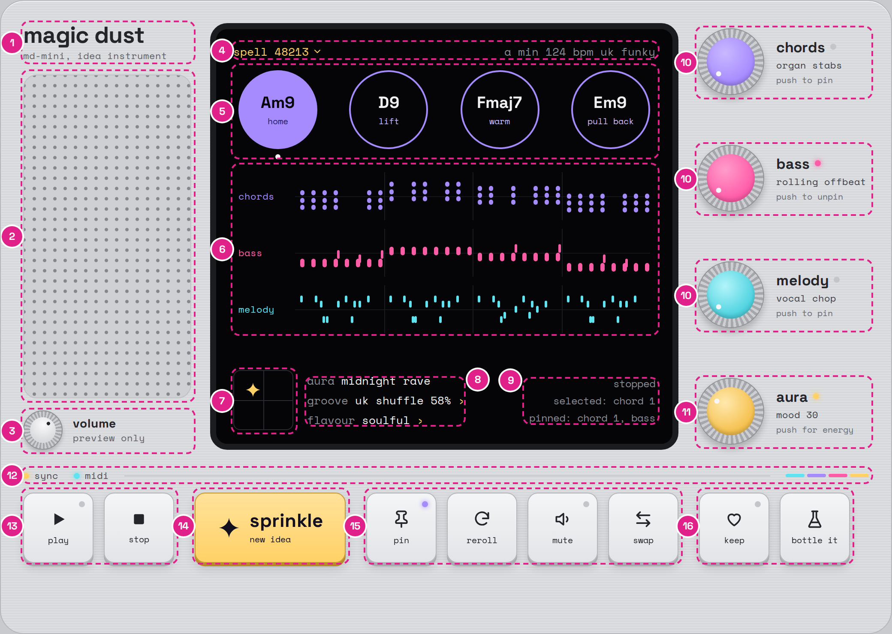

# Magic Dust: visual spec

Version 1.0, 26 October 2026.
Companion to `magic-dust-spec.md`, which covers the product, music engine, architecture, build plan, testing and release.

This document defines exactly how the Magic Dust plugin window looks and behaves.
Where this document and the reference HTML disagree, the reference HTML wins for appearance and this document wins for behaviour, and the disagreement goes in `docs/DECISIONS.md`.

## Files

| File | What it is | How to use it |
| --- | --- | --- |
| `visual/magic-dust-reference.html` | A playable reference of the whole window in plain HTML, CSS and JavaScript. | Open it in a browser. Read its CSS custom properties for exact token values and its class names for component names. Interact with it to see every behaviour. |
| `visual/magic-dust-ui.png` | The default state at 2x. | The visual target for the default state. |
| `visual/magic-dust-ui-annotated.png` | The default state with numbered zones. | The numbers match the "Components" section below. |
| `visual/magic-dust-ui-states.png` | Playing, pinned chords, a selected and pinned lane, a muted lane, the spells panel and a toast. | The visual target for those states. |

The note patterns in the reference are illustrative placeholders.
In the plugin, every note on the screen is drawn from the engine's real output (see "Lanes").

## Rules for building the look in JUCE

- Draw everything as vectors in `paint()` and a custom `LookAndFeel`.
  Never paste the reference images into the plugin.
- The editor's logical size is 1040 x 740 px.
  It is resizable from 80% to 150% with a fixed aspect ratio, using `setResizable`, `setResizeLimits` and the constrainer's `setFixedAspectRatio`.
  Scale the whole component tree with one transform so every measurement in this document stays true at every size.
- Embed Space Grotesk (500 and 700) and Space Mono (400 and 700) as binary data and load them with `juce::Typeface::createSystemTypefaceFor`.
  Both families use the SIL Open Font License; ship the licence text with the plugin.
- Use shading only where this document lists it (see "Materials").
  Everything else is flat.
- Match positions and sizes to within 1 px at 100% scale.
  The UI snapshot tests compare the JUCE editor with approved renders of the JUCE editor itself; use the reference PNGs for the human side-by-side review, because browser and JUCE text rendering differ slightly.
- All text on the body and the screen is lowercase, except chord symbols such as `Am9`.
- Never use the em dash character in any interface text.

## Layout

All coordinates are in logical pixels, measured from the top-left corner of the window.
They were measured from the reference HTML.

### Zones

| Zone | x | y | Width | Height | Notes |
| --- | --- | --- | --- | --- | --- |
| Body | 0 | 0 | 1040 | 740 | 1 px border, 28 px corner radius, 26 px padding inside the border |
| Top area | 27 | 27 | 986 | 498 | Three columns: 196, 546 and 200 px, with 22 px gaps |
| Left column | 27 | 27 | 196 | 498 | Wordmark, grille and volume, 14 px gaps |
| Wordmark | 27 | 27 | 196 | 46 | |
| Speaker grille | 27 | 87 | 196 | 378 | Fills the space between wordmark and volume |
| Volume | 27 | 479 | 196 | 46 | |
| Screen, outer edge | 245 | 27 | 546 | 498 | Includes the 7 px bezel |
| Screen content box | 272 | 50 | 492 | 452 | 16 px top and bottom padding, 20 px left and right, inside the bezel |
| Top line | 272 | 50 | 492 | 20 | |
| Chord bubbles row | 272 | 82 | 492 | 104 | Four 92 px bubbles, 6 px side padding, evenly spaced |
| Lanes | 272 | 198 | 492 | 194 | Three rows of 62 px with 4 px gaps |
| Status strip | 272 | 432 | 492 | 70 | Pinned to the bottom of the screen content box |
| Encoder column | 813 | 27 | 200 | 498 | Four rows, 6 px top and bottom padding, evenly spaced |
| Bottom area | 27 | 547 | 986 | 166 | Status line, 12 px gap, keys |
| Status line | 27 | 547 | 986 | 16 | |
| Keys row | 27 | 575 | 986 | 82 | |

### Positions inside the zones

| Element | Position and size |
| --- | --- |
| Chord bubbles | 92 x 92 px at x = 278, 407, 537 and 666 (y = 82). The selected dot sits 6 px below each bubble. |
| Lane rows | 492 x 62 px at y = 198, 264 and 330. Each has 3 px vertical and 6 px horizontal padding, an 8 px corner radius, a 56 px label column at x = 278, and a piano roll of 414 x 56 px at x = 344. |
| Aura pad | 70 x 70 px at x = 272, y = 432. |
| Status fields | Left edge at x = 358, three lines of 13 px text, 3 px apart. |
| Readout | Right-aligned to x = 764, three lines of 12 px text, 3 px apart. |
| Encoders | 78 x 78 px at x = 813, with rows at y = 33, 169, 305 and 441. The cap is 56 x 56 px, inset 10 px. Text starts 14 px to the right of the encoder. |
| Keys | 82 x 82 px. Play at x = 27, stop 121, sprinkle 227 (176 px wide), pin 427, reroll 521, mute 615, swap 709, keep 815, bottle it 909, all at y = 575. Keys within a group are 12 px apart; groups are 24 px apart. |
| Spells panel | 340 px wide, 14 px from the screen's left inner edge and 40 px below its top inner edge. |
| Toast | Centred horizontally on the screen, 96 px above the screen's bottom inner edge. |

## Colour tokens

Use these names in code (for example as constants in `ui/Tokens.h`) so the reference CSS and the plugin stay in step.

| Token | Value | Used for |
| --- | --- | --- |
| `body` | `#DCDDE0` | Instrument body |
| `body-edge` | `#B4B6BB` | Body outline |
| `grille` | `#CFD0D4` | Speaker grille fill |
| `grille-edge` | `#BFC1C6` | Speaker grille outline |
| `grille-dot` | `#85878E` | Speaker grille holes |
| `ink` | `#24252B` | Main engraved text and icons |
| `ink-quiet` | `#5E6068` | Secondary engraved text |
| `ink-value` | `#3B3D44` | Encoder values |
| `ink-faint` | `#6A6C74` | Encoder hints |
| `ink-status` | `#4A4C54` | Status line text |
| `screen` | `#050507` | Screen background |
| `bezel` | `#1B1C20` | Screen bezel |
| `screen-ink` | `#F2F2F5` | Main screen text |
| `screen-quiet` | `#8A8C96` | Secondary screen text |
| `screen-axis` | `#15161B` | Centre line of each piano roll |
| `screen-bar` | `#1A1B21` | Bar lines every two bars |
| `screen-line` | `#2A2B32` | Aura pad frame and crosshair, panel borders |
| `screen-selected` | `#121318` | Selected lane background |
| `screen-panel` | `#0D0E12` | Spells panel background |
| `spell-current` | `#1A1B22` | Current row in the spells panel |
| `key-top` | `#F4F5F6` | Keycap gradient, top |
| `key-bottom` | `#E3E4E7` | Keycap gradient, bottom |
| `key-edge` | `#B4B6BB` | Keycap outline |
| `key-base` | `#A9ABB0` | Keycap base (the solid shadow) |
| `knurl-light` | `#CDCED2` | Encoder rim, light ridges |
| `knurl-dark` | `#A5A7AC` | Encoder rim, dark ridges |
| `knurl-edge` | `#8E9096` | Encoder rim outline |
| `led-off` | `#C3C5CA` | Unlit LED |
| `cyan` | `#5FE3F0` | Melody lane, melody notes, midi LED |
| `violet` | `#A68BFF` | Chords lane, chord bubbles, chord notes, pin LED |
| `violet-soft` | `#C9B8FF` | Feel words, chord names in the spells panel |
| `violet-deep` | `#2B1F5C` | Feel word on a pinned bubble |
| `magenta` | `#FF5CA8` | Bass lane, bass notes, mute LED |
| `gold` | `#FFD166` | Sprinkle key, playhead, spell number, aura sparkle, toast, play and keep LEDs |
| `gold-light` | `#FFE29A` | Sprinkle key gradient, top |
| `gold-edge` | `#C9992F` | Sprinkle key outline |
| `gold-base` | `#B88A2A` | Sprinkle key base |
| `on-colour` | `#050507` | Text on any coloured fill |
| `focus` | `#8C6CF5` | Keyboard focus ring on the body |

The four dust colours form one spectrum in this order: cyan, violet, magenta, gold.
They appear only as light (on the screen, in LEDs) and as encoder caps.

## Typography

| Role | Font | Size | Weight | Colour |
| --- | --- | --- | --- | --- |
| Wordmark "magic dust" | Space Grotesk | 27 px, letter spacing -0.5 px, line height 1.05 | 700 | `ink` |
| Wordmark subline "md-mini, idea instrument" | Space Mono | 11 px | 400 | `ink-quiet` |
| Volume name | Space Grotesk | 14 px | 700 | `ink` |
| Volume hint "preview only" | Space Mono | 11 px | 400 | `ink-quiet` |
| Screen top line | Space Mono | 13 px | 400 | Spell number `gold`; key, tempo and style `screen-quiet` |
| Chord name in a bubble | Space Grotesk | 19 px, or 16 px when longer than 5 characters | 700 | `screen-ink`; `on-colour` when pinned |
| Feel word in a bubble | Space Mono | 10 px | 400 | `violet-soft`; `violet-deep` when pinned |
| Lane label | Space Mono | 11 px | 400 | Lane colour; `screen-ink` when selected |
| Status fields | Space Mono | 13 px | 400 | Field name `screen-quiet`, value `screen-ink`, chevron `gold` |
| Readout | Space Mono | 12 px | 400 | `screen-quiet`; the bar position is `gold` while playing |
| Spells panel title | Space Mono | 11 px | 400 | `screen-quiet` |
| Spells panel rows | Space Mono | 12 px | 400 | Seed and "kept" `gold`, chord names `violet-soft` |
| Toast | Space Mono | 12 px | 700 | `on-colour` on `gold` |
| Encoder name | Space Grotesk | 17 px | 700 | `ink` |
| Encoder value | Space Mono | 11 px | 400 | `ink-value` |
| Encoder hint | Space Mono | 10 px | 400 | `ink-faint` |
| Status line | Space Mono | 11 px | 400 | `ink-status` |
| Key label | Space Mono | 10 px | 400 | `ink` |
| Sprinkle title | Space Grotesk | 22 px, line height 1 | 700 | `#12101F` |
| Sprinkle subline "new idea" | Space Mono | 10 px | 400 | `#12101F` |

## Materials

These are the only places shading is allowed.

| Material | Recipe |
| --- | --- |
| Body | Fill `body`. Brushed texture: horizontal 1 px lines of white at 9% opacity every 3 px, with black at 2.5% opacity between them. Inner top highlight: 1 px white at 75% opacity. Border 1 px `body-edge`. Corner radius 28 px. |
| Speaker grille | Fill `grille`, border 1 px `grille-edge`, corner radius 16 px. Round holes of 1.7 px radius in `grille-dot` on a 12 px grid, offset 6 px from the top-left. |
| Screen | Fill `screen`, 7 px `bezel` border, corner radius 20 px (outer edge). |
| Encoder rim | Knurled ring: 72 alternating wedges of `knurl-light` and `knurl-dark` (36 of each), each 5 degrees wide. Border 1 px `knurl-edge`. Drop shadow 0 5 px 8 px black at 20%. |
| Encoder cap | 56 px circle, radial gradient with the highlight at 38% across and 32% down. Chords `#C9B8FF` to `#A68BFF`, bass `#FF9CCB` to `#FF5CA8`, melody `#B2F4FA` to `#4FD3E0`, aura `#FFE8AD` to `#F5C14F`; the second colour is reached at 68% of the radius. Inner shadow 0 -3 px 4 px black at 18% along the bottom. |
| Encoder pointer | 6 px dot in `#F7F7F9`, centred 8 px below the top of the cap, rotating about the cap's centre from -135 to +135 degrees. |
| Volume knob | 46 px knurled rim with 60 alternating wedges of 6 degrees each, a 30 px cap with a radial gradient from `#FAFAFB` to `#D9DADD`, and a 4 px `ink` dot. |
| Keycap | 82 x 82 px, corner radius 12 px, vertical gradient `key-top` to `key-bottom`, border 1 px `key-edge`. Base: a solid 4 px offset in `key-base` below the key, plus a soft shadow 0 6 px 10 px black at 12%. |
| Keycap, pressed | Moves down 3 px; the solid base shrinks to 1 px and the soft shadow to 0 2 px 4 px. |
| Sprinkle key | 176 x 82 px, vertical gradient `gold-light` to `gold`, border 1 px `gold-edge`, solid base `gold-base`, soft shadow 0 6 px 12 px black at 14%. |
| LED | 7 px circle. Off: `led-off`. On: the LED's colour plus a 6 px glow in the same colour. |

## Components

The numbers match `visual/magic-dust-ui-annotated.png`.

### 1. Wordmark

- "magic dust" with the subline "md-mini, idea instrument" beneath it.
- Not interactive.

### 2. Speaker grille

- Decorative.
- While the preview plays, it brightens by 8% and back once per beat, following the host tempo (484 ms per beat at 124 BPM).

### 3. Volume

- Sets the audition synth's output level only; it never affects the MIDI.
- Drag up or down to turn it; double-click resets it to 80%.

### 4. Screen top line

- The spell number (the current idea's seed) is a button in `gold` with a small down chevron.
  Clicking it opens and closes the spells panel.
- Key, tempo and style sit on the right in `screen-quiet`.
  Key and style are buttons that open menus; the style menu ends with "manage bank".
  Tempo is read from Live and is not editable.

### 5. Chord bubbles

| State | Look |
| --- | --- |
| Default | 2 px `violet` ring, transparent fill, name in `screen-ink`, feel word in `violet-soft` |
| Pinned | Filled `violet`, name in `on-colour`, feel word in `violet-deep` |
| Playing | A 2 px `gold` ring outside the bubble, separated by a 4 px `screen` gap |
| Selected | A 6 px `screen-ink` dot centred 6 px below the bubble |
| Focused | 2 px `gold` focus outline, 3 px outside the bubble |

- Click: select the bubble and audition its chord.
- Drag (more than 4 px of movement): drag that chord into Ableton as a MIDI clip.
- When a chord changes, its name pops in (see "Motion").

### 6. Lanes

- Three rows: chords (`violet`), bass (`magenta`) and melody (`cyan`).
- Each row has a 56 px label and a 414 x 56 px piano roll with a centre line in `screen-axis`, bar lines every two bars in `screen-bar`, and a 2 px `gold` playhead while playing.
- Notes are rounded rectangles (3 px radius) in the lane colour.
  Horizontal position and width come from the note's start and length across the 8 bars.
  Vertical position comes from pitch, with the highest pitch at the top: chords span MIDI 48 to 79, bass 28 to 48, and melody 60 to 84.
- Selected: the row background becomes `screen-selected` and the label turns `screen-ink`.
- Muted: the label drops to 45% opacity and the piano roll to 30%.
- Click: select the lane.
  Drag (more than 4 px of movement): drag the lane into Ableton as a MIDI clip.

### 7. Aura pad

- 70 x 70 px frame and crosshair in `screen-line`, with a 20 px `gold` sparkle.
- Left to right is mood (darker to brighter); bottom to top is energy (calm to wild).
  The sparkle's centre stays at least 8% in from each edge.
- Click or drag anywhere on the pad to move the sparkle.
  Unpinned parts regenerate 150 ms after movement stops.

### 8. Status fields

- "aura" shows the current quadrant and is not clickable: midnight rave (darker and wild), starburst (brighter and wild), moonlight (darker and calm), daydream (brighter and calm).
- "groove" cycles through straight, swing 54%, uk shuffle 58% and heavy 62% on click; the scroll wheel steps forwards and back.
- "flavour" cycles through simple, soulful and jazzy on click and regenerates unpinned chords.
- Each clickable field ends with a `gold` chevron.

### 9. Readout

- Line 1: "stopped", or "bar 3 of 8" in `gold` while playing.
- Line 2: "selected: chord 2" or "selected: bass".
- Line 3: "nothing pinned", or "pinned: chord 1, bass".

### 10. Lane encoders

- One each for chords, bass and melody.
- Value: the lane's pattern name.
  The pointer angle is -135 degrees plus (pattern index divided by (pattern count minus 1)) times 270 degrees.
- Drag up or down: one pattern step per 16 px of movement.
  The scroll wheel steps one pattern per notch.
- Click without dragging (the "push"): pin or unpin the lane, and select it.
- LED next to the name: lit in the lane colour while the lane is pinned.
- Hint line: "push to pin", or "push to unpin" when pinned.
- Turning a pinned encoder changes nothing and shows the toast "unpin the bass lane to turn it" (with the lane's name).
- Keyboard: arrow up and down step the pattern; Enter or Space pins.

| Lane | Patterns, in order |
| --- | --- |
| Chords | organ stabs, piano chops, long pads, offbeat stabs |
| Bass | rolling offbeat, offbeat, octave bounce, garage skip, sustained |
| Melody | vocal chop, hook, riff, sparse |

### 11. Aura encoder

- Value: "mood 30" or "energy 72" (0 to 100), depending on its mode.
- Drag up or down: 160 px covers the full range.
  The scroll wheel moves 5 per notch.
- Click without dragging: switch between mood and energy.
  The hint reads "push for energy" or "push for mood".
- Releasing after a drag regenerates unpinned parts.
- Its LED is always lit `gold`.

### 12. Status line

- "sync" LED: `gold` while the plugin is following Live's transport.
- "midi" LED: `cyan` while MIDI output is active.
- A thin rule in `#C3C5CA` fills the middle.
- The four-colour spectrum strip on the right (22 x 4 px bars, 3 px apart) is decorative.

### 13. Play and stop

- Play starts the preview; its LED is `gold` while playing.
- Stop ends the preview and returns to bar 1.
- While Live is playing, the preview follows Live's position instead.

### 14. Sprinkle

- Writes a new idea, keeping everything pinned, and adds it to the spells list (8 most recent).
- The largest and only gold key.

### 15. Pin, reroll, mute and swap

These act on the current selection (a chord bubble or a lane).

| Key | On a chord | On a lane | LED |
| --- | --- | --- | --- |
| pin | Pins or unpins the chord | Pins or unpins the lane | `violet` while the selected item is pinned |
| reroll | Picks a different chord for that slot; unpinned bass and chord lanes follow | Rewrites the lane with a new seed | None |
| mute | Toast: "select a lane to mute it" | Mutes or unmutes the lane | `magenta` while the selected lane is muted |
| swap | Steps to the next ranked alternative; unpinned bass and chord lanes follow | Toast: "select a chord bubble to swap it" | None |

Rerolling or swapping a pinned item changes nothing and shows "unpin it first" (reroll) or "unpin the chord to swap it" (swap).

### 16. Keep and bottle it

- Keep: adds or removes the idea from favourites, with the toast "kept in favourites" or "removed from favourites".
  Its LED is `gold` while the current idea is kept.
- Bottle it: drag from this key to drop the whole idea into Ableton.
  A plain click shows the toast "drag me into ableton: chords, bass and melody".

### Sender screen

- Shown by any Magic Dust instance that sends one lane to another track (see `docs/DECISIONS.md`).
  It is 520 x 240 px, on the body material, and scales and resizes like the main window.
- Title "magic dust sender" at 27, 27: the wordmark style (Space Grotesk 700, 27 px, letter spacing -0.5 px, `ink`).
- Keycaps "chords", "bass" and "melody" at y 100, 82 px wide, 12 px apart, starting at x 27.
  Each has an LED in its lane colour (chords `violet`, bass `magenta`, melody `cyan`), lit on the lane being sent.
  Clicking a key selects that lane.
- A fourth keycap "full magic dust", 120 px wide, 24 px to the right of the third, at x 321.
  Clicking it turns the instance into a full Magic Dust and the window becomes the main window.
- All four keys use the keycap material; the label is Space Mono 10 px, `ink`, centred.
- Status text at 27, 200, Space Mono 11 px, `ink-status`: "sending bass from magic dust" (the chosen lane), or "no magic dust found - load magic dust on another track first" when there is no main instance to follow.

### Spells panel

- Opens below the spell number, over the bubbles.
- Background `screen-panel`, border 1 px `screen-line`, corner radius 12 px, 8 px padding.
- Title "recent spells", then one row per spell, newest first: the seed, the four chord names, and "kept" if it is a favourite.
  The current spell's row has a `spell-current` background.
- Clicking a row restores that idea and closes the panel.
  Clicking the spell number again or pressing Escape closes it.

### Toast

- A `gold` pill with `on-colour` text, 6 px by 14 px padding, fully rounded ends.
- Appears for 1.7 seconds; a new toast replaces the current one.

## Motion

| Element | Trigger | Animation | Duration and easing |
| --- | --- | --- | --- |
| Notes | A lane is regenerated | Each note fades in while scaling 0.1, then 1.3, then 1. Each note's delay is its horizontal position in percent times 3.2 ms, capped at 320 ms, so the dust sweeps left to right. | 420 ms, cubic-bezier(0.2, 0.8, 0.2, 1) |
| Chord name | A chord changes | Fades in while scaling 0.5, then 1.12, then 1 | 380 ms, ease-out |
| Encoder pointer | The value changes | Rotates to the new angle | 120 ms, ease-out |
| Key | Pressed | Moves down 3 px; the base shadow shrinks | 80 ms, ease-out |
| LED | Turns on or off | Colour and glow fade | 120 ms |
| Bubble | Pinned or playing state changes | Fill and ring fade | 120 ms, ease-out |
| Speaker grille | Preview playing | Brightness 100%, 108%, 100% once per beat | One beat, ease-in-out, repeating |

Pinned parts never animate when other parts regenerate.
A "motion" setting turns every animation off, and the plugin also turns them off when macOS "Reduce motion" is on.

## Accessibility

- Every interactive element is keyboard-focusable in reading order: top line, bubbles, lanes, aura pad, status fields, encoders, then keys from left to right.
- Focus ring: 2 px `focus`, 3 px outside the element on the body; 2 px `gold` on the screen.
- Every control has an accessible title through `juce::AccessibilityHandler`, for example "Chord 1, Am9, home, pinned", "bass encoder, rolling offbeat, pinned" and "Pin the selected chord or lane".
  Encoders also report their value.
- Text contrast is at least 4.5:1 against its background.
- Colour never carries meaning alone: lanes, encoders and LEDs always sit next to a text label.

## JUCE component map

| Reference class | JUCE component | Notes |
| --- | --- | --- |
| `md-body` | `MagicDustEditor` (the `AudioProcessorEditor`) | Paints the body, owns the scale transform |
| `md-left` | `LeftPanel` | Wordmark, `GrilleComponent`, `VolumeKnob` |
| `md-screen` | `ScreenComponent` | Paints bezel and screen; owns the children below |
| `md-topline` | `TopLine` | `SpellButton`, `KeyMenuButton`, tempo label, `StyleMenuButton` |
| `md-bubble` | `ChordBubble` (x4) | Custom `juce::Button`; starts an external drag after 4 px of movement |
| `md-lane` | `LaneView` (x3) | Custom component with a `PianoRoll` child; starts an external drag after 4 px of movement |
| `md-aura` | `AuraPad` | Custom component |
| `md-fields`, `md-readout` | `StatusFields`, `Readout` | |
| `md-spells` | `SpellsPanel` | Child of the screen, not a separate window |
| `md-toast` | `Toast` | Child of the screen; hidden by a timer |
| `md-encoder` | `Encoder` (x4) | Subclass of `juce::Slider` in `RotaryVerticalDrag` mode with custom drawing; a click without drag is the push |
| `md-key` | `KeyButton` | Custom `juce::Button` with an optional LED |
| `md-key--gold` | `SprinkleKey` | |
| `md-key--drag` | `BottleKey` | Starts an external drag of the multi-track MIDI file |
